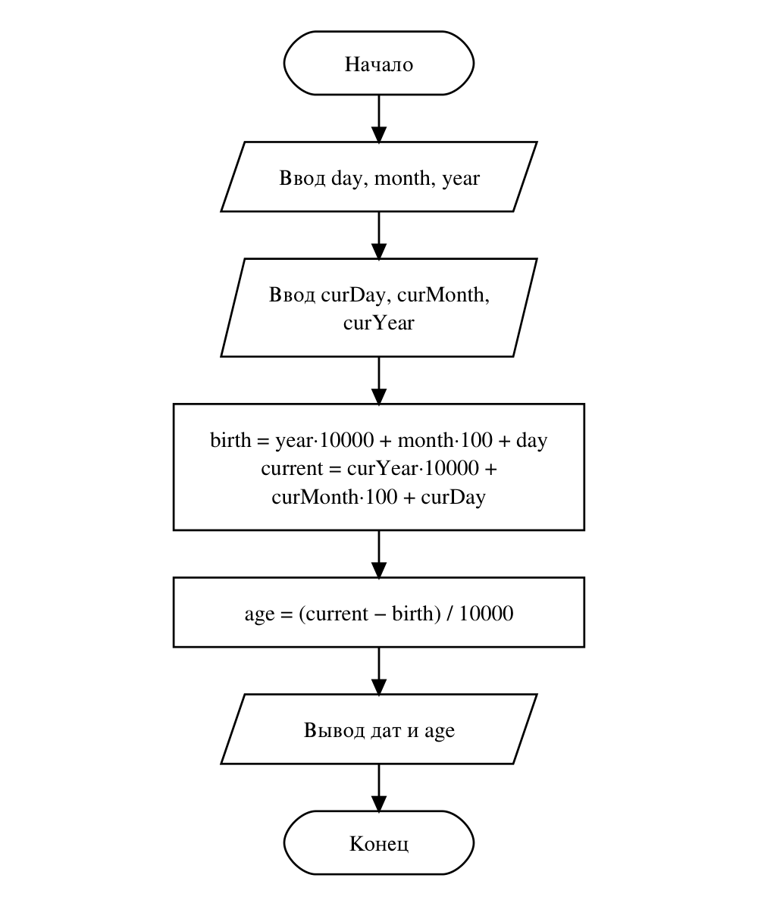

# Домашнее задание к работе №3
Вариант 10

## Условие задачи
Написать и отладить программу вычисления возраста по дате рождения.

## 1. Алгоритм и блок-схема
### Алгоритм:
1. Начало.
2. Объявить переменные:
- **day, month, year** — дата рождения;
- **curDay, curMonth, curYear** — сегодняшняя дата;
- **birth, current** — даты, записанные одним числом;
- **age** — возраст в полных годах.
3. Ввести дату рождения и сегодняшнюю дату.
4. Записать каждую дату одним числом вида ггггммдд: **birth = year · 10000 + month · 100 + day**, так же для **current**.
5. Вычислить возраст **age = (current − birth) / 10000**. Годы стоят в старших разрядах, поэтому целочисленное деление на 10000 дает число полных лет; если день рождения в этом году еще не наступил, год не засчитывается.
6. Вывести обе даты и возраст.
7. Конец.

### Блок-схема:


## 2. Реализация программы
```c
#define _CRT_SECURE_NO_DEPRECATE
#include <stdio.h>
#include <locale.h>

// Вариант 10
// Вычисление возраста по дате рождения
int main() {
    setlocale(LC_CTYPE, "RUS");
    int day, month, year;
    int curDay, curMonth, curYear;
    int birth, current, age;
    puts("Введите дату рождения (дд мм гггг)");
    scanf("%d %d %d", &day, &month, &year); // дата рождения
    puts("Введите сегодняшнюю дату (дд мм гггг)");
    scanf("%d %d %d", &curDay, &curMonth, &curYear); // сегодняшняя дату

    // Склеиваем дату в одно число
    // Так более поздняя дата всегда дает большее число
    birth = year * 10000 + month * 100 + day;
    current = curYear * 10000 + curMonth * 100 + curDay;
    age = (current - birth) / 10000; // годы стоят в старших разрядах, поэтому делим разницу на 10000

    printf("Дата рождения: %02d.%02d.%d\n", day, month, year);
    printf("Сегодня: %02d.%02d.%d\n", curDay, curMonth, curYear);
    printf("Возраст: %d (полных лет)\n", age);
    return 0;
}
```

## 3. Результаты работы программы
Случай 1:
```
Введите дату рождения (дд мм гггг)
15 03 2007
Введите сегодняшнюю дату (дд мм гггг)
08 10 2026
Дата рождения: 15.03.2007
Сегодня: 08.10.2026
Возраст: 19 (полных лет)
```
Случай 2:
```
Введите дату рождения (дд мм гггг)
20 11 2006
Введите сегодняшнюю дату (дд мм гггг)
08 10 2026
Дата рождения: 20.11.2006
Сегодня: 08.10.2026
Возраст: 19 (полных лет)
```

## 4. Информация о разработчике
Файко Андрей Юрьевич, бТИИ-262
